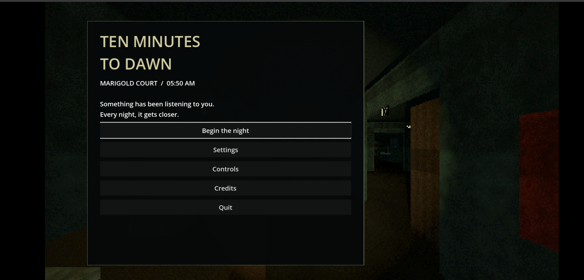
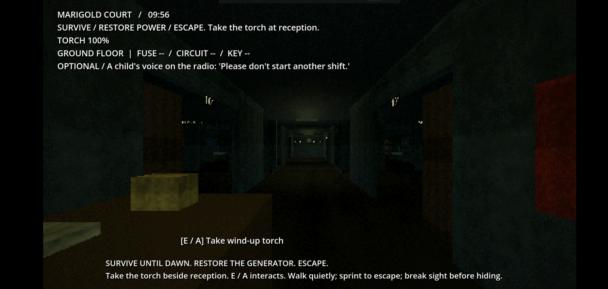
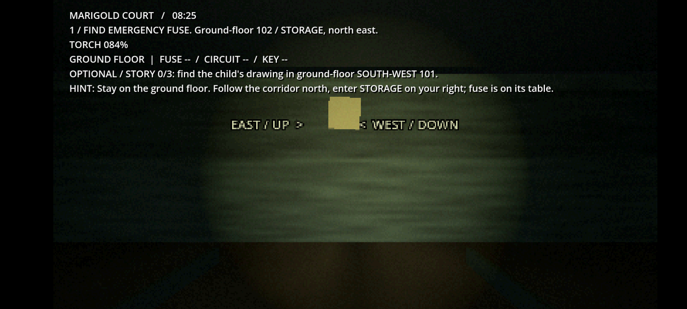
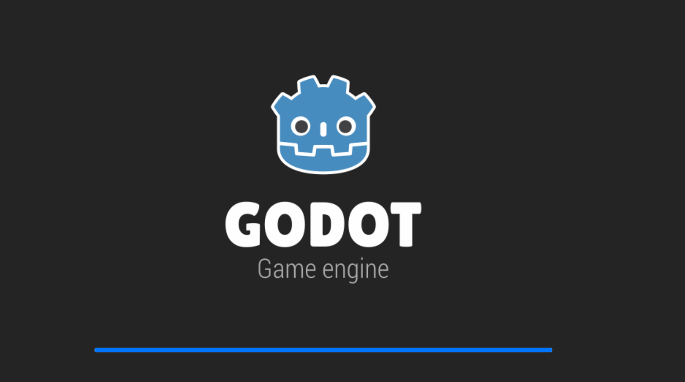

<div align="center">

# TEN MINUTES TO DAWN

### THE NIGHT IS LONG. THE WAY OUT IS NOT GUARANTEED.

*A first-person survival horror experience set inside Marigold Court.*


</div>

---

## ▶ Play online

[**Play TEN MINUTES TO DAWN in your browser →**](https://pranavpk-05.github.io/TEN-MINUTES-TO-DAWN/)

[](https://github.com/pranavpk-05/TEN-MINUTES-TO-DAWN/actions/workflows/deploy-pages.yml)

The browser build is published from the Godot Web export in `TenMinutesToDawn-Web.zip`. The link becomes playable after the first successful Pages deployment.

## About the game

**Ten Minutes to Dawn** is a first-person survival horror game that places you inside Marigold Court, a dark and unsettling location where something seems to be getting closer every night.

Your objective is to survive, restore the building's power, and find a way to escape. Explore the corridors, manage your torch, locate essential items, and pay attention to the clues left around the building.

> Something has been listening to you.  
> Every night, it gets closer.

## Screenshots

### Main menu



### Explore Marigold Court



### Find the emergency fuse



### Game startup



## Your objective

Survive until dawn. Restore the generator. Escape.

Your main objectives include:

- **Explore:** Navigate the ground floor and investigate Marigold Court.
- **Find the torch:** Take the wind-up torch at reception to help you navigate the darkness.
- **Restore power:** Locate the emergency fuse and the components needed to bring the power back.
- **Find a way out:** Complete your objectives and escape.
- **Uncover the story:** Look for optional story clues, including a child's drawing.

## Gameplay

The game focuses on exploration, survival, and interacting with the environment.

| Mechanic | Description |
|---|---|
| Exploration | Search rooms and corridors for useful items and clues. |
| Torch | Use the wind-up torch to navigate dark areas. |
| Objectives | Follow the on-screen instructions to progress. |
| Interaction | Interact with objects and important items. |
| Story clues | Discover optional details about what happened at Marigold Court. |

## Controls

| Action | Control |
|---|---|
| Interact / pick up objects | `E` / `A` (as shown in-game) |
| Other movement and camera controls | See the in-game **Controls** menu |

*Check the in-game Controls menu for the complete keyboard and mouse mapping.*

## Play the game

### Download

1. Open the repository's [Releases page](https://github.com/pranavpk-05/TEN-MINUTES-TO-DAWN/releases).
2. Download the latest `TenMinutesToDawn-Web.zip` build.
3. Extract the ZIP archive.
4. Run the exported web build using a compatible local web server or the hosted game page, if available.

> **Note:** A Godot web export may require a web server; opening `index.html` directly as a local file may not work in every browser.

## Built with

- **Godot Engine** — game engine.
- **Godot Web export** — browser-targeted game build.

## Repository contents

```text
TEN-MINUTES-TO-DAWN/
├── README.md
├── screenshots/
│   ├── godot-loading.png
│   ├── main-menu.png
│   ├── gameplay-torch-objective.png
│   └── gameplay-fuse-objective.png
└── TenMinutesToDawn-Web.zip
```

*The repository layout above illustrates the recommended organization. Keep the ZIP wherever it currently lives, or adjust the paths to match your repository.*

## Credits

Created by **Pranav K Kannan**.

- GitHub: [@pranavpk-05](https://github.com/pranavpk-05)

## License

No license has been specified yet. Unless a license is added to this repository, the project remains subject to its applicable copyright protections. Please contact the author before redistributing or reusing the game assets.

---

<div align="center">

**DON'T LET THE NIGHT KEEP YOU.**

[Repository](https://github.com/pranavpk-05/TEN-MINUTES-TO-DAWN) · [Releases](https://github.com/pranavpk-05/TEN-MINUTES-TO-DAWN/releases)

</div>
