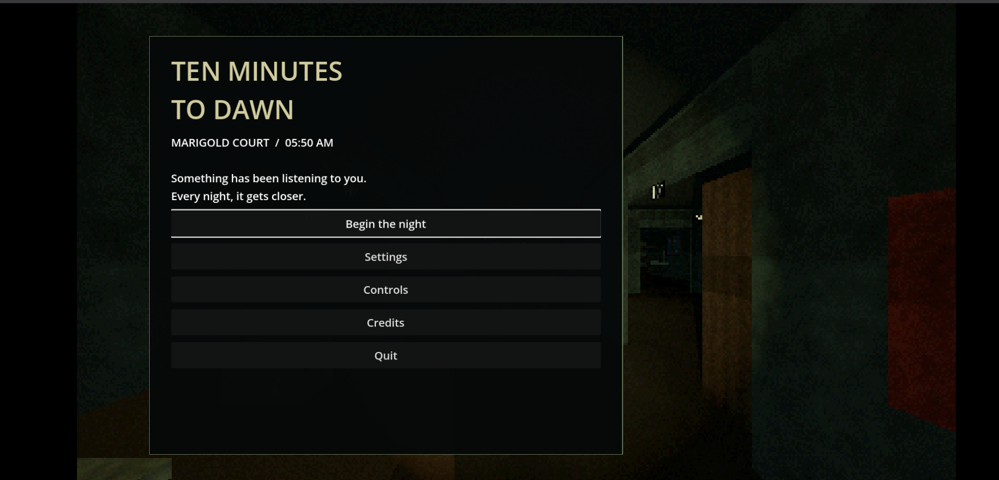

# 🌅 TEN MINUTES TO DAWN

<p align="center">
  <strong>A fast-paced survival roguelike where every second counts.</strong>
</p>

<p align="center">
  
  
  
</p>

<p align="center">
  <a href="https://github.com/pranavpk-05/TEN-MINUTES-TO-DAWN/releases">
    <strong>⬇ Download Game</strong>
  </a>
  &nbsp; • &nbsp;
  <a href="https://github.com/pranavpk-05/TEN-MINUTES-TO-DAWN">
    <strong>Explore Repository</strong>
  </a>
</p>

---

## 🎮 About The Game

**Ten Minutes to Dawn** is a fast-paced survival roguelike game focused on intense combat, enemy waves, and strategic upgrades.

Your objective is simple: survive the relentless darkness, eliminate enemies, strengthen your abilities, and make it through the challenge.

Every run is an opportunity to improve your strategy and push your survival skills further.

## ✨ Features

- ⚔️ Fast-paced survival combat
- 👾 Challenging enemy encounters
- 🔥 Intense action-oriented gameplay
- ⚡ Character upgrades and abilities
- 🎯 Skill-based survival mechanics
- 🌐 Web build for browser-based gameplay

*Features may vary depending on the current game build.*

## 📸 Gameplay Screenshots

<!-- Add your screenshots to the screenshots/ directory -->

<p align="center">
  
  
</p>

<p align="center">
  
</p>

## 🕹️ Controls

| Action | Controls |
|---|---|
| Movement | WASD / Arrow Keys |
| Aim | Mouse |
| Shoot | Mouse Button |
| Special Abilities | As configured in-game |

*Update this table if your actual game controls differ.*

## 🚀 Getting Started

### Download and Play

1. Visit the [Releases](https://github.com/pranavpk-05/TEN-MINUTES-TO-DAWN/releases) section.
2. Download the latest `TenMinutesToDawn-Web.zip`.
3. Extract the ZIP file.
4. Open the exported `index.html` using a compatible web server if required by the build.
5. Start playing!

### Download the Source

```bash
git clone https://github.com/pranavpk-05/TEN-MINUTES-TO-DAWN.git
```

## 📦 Project Structure

```text
TEN-MINUTES-TO-DAWN/
│
├── screenshots/
│   ├── main-menu.png
│   ├── gameplay.png
│   └── boss-fight.png
│
├── builds/
│   └── TenMinutesToDawn-Web.zip
│
├── README.md
└── LICENSE
```

## 🛠️ Technology

- Web-exported game build
- HTML5 / Web technologies (export output)
- Original game engine and development tools: update with the actual engine and technologies used.

## 🗺️ Roadmap

- [x] Initial Web build
- [x] GitHub repository setup
- [ ] Improve gameplay presentation
- [ ] Add additional gameplay screenshots
- [ ] Publish versioned releases
- [ ] Deploy playable Web Edition

## 📥 Releases

Download the latest available build:

**[View All Releases →](https://github.com/pranavpk-05/TEN-MINUTES-TO-DAWN/releases)**

## 🤝 Contributions

Contributions, suggestions, and bug reports are welcome.

If you discover an issue or have an idea for improvement, feel free to open an issue or submit a pull request.

## 📄 License

Please refer to the [LICENSE](LICENSE) file for the terms governing the use and distribution of this project.

If no license has been added yet, the project remains under its applicable default copyright protections.

## 👨‍💻 Author

**Pranav K Kannan**

- GitHub: [@pranavpk-05](https://github.com/pranavpk-05)

---

<p align="center">
  <strong>🌅 Survive the darkness. Make it to dawn.</strong>
</p>

<p align="center">
  ⭐ If you enjoy the project, consider giving this repository a star!
</p>
